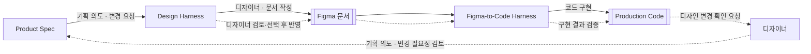

# Figma 디자인-코드 하네스

- 크루원: 전지원
- 개인 저장소: _(작성 예정)_
- 마지막 갱신: 2026-11-19 (1-2주차 문제 정의, 6주차 진행 기록 기준 초안)

> 리더가 스터디 기록을 옮겨 만든 초안입니다. 직접 다듬어 주세요.
> 회사 관련 정보는 마스킹하거나 빼 주세요. 이 저장소는 공개 저장소입니다.

## 한 줄 소개

디자이너가 일정한 규칙으로 Figma 문서를 만들고, 개발자는 Figma 컴포넌트 설계대로 구현한 뒤 Figma와 코드의 차이를 항목별로 비교·반영하게 하는 디자인-코드 하네스(플러그인)

## 문제 정의

**Figma 전달물과 코드 사이의 차이를 디자이너와 개발자가 사람 손으로 찾고, 매번 개별 지시로 메우고 있다.**

### AS-IS

| 대상 | 현재 겪는 문제 |
| --- | --- |
| 디자이너 | 공통 프롬프트를 매번 작성하고, Figma 문서 구성과 표현이 기능마다 다르다. 코드와 Figma의 차이를 직접 찾아 AI에게 개별 수정 지시한다 |
| 개발자 | Figma 화면 하나의 구현 결과가 한꺼번에 와서 전체 변경을 한 번에 리뷰한다. Figma에 완성된 컴포넌트·상태가 있는데도 구현 과정에서 차이가 생긴다(변수명, 상태값 등). Figma 정보량이 많아 모든 화면과 상태를 직접 비교하지 못한다 |

### 원인

- 디자이너: 공통 규칙보다 개별 요청에 따라 문서 작성 방식이 정해진다. 코드 변경과 관련 Figma 항목을 연결할 정보가 부족하다.
- 개발자: 구현 단위를 나누는 기준과 단계별 리뷰 시점이 없다. Figma 컴포넌트 설계를 코드에 대응시키고 반영 여부를 보고하는 규칙이 부족하다. 화면·컴포넌트·상태가 비교할 단위로 정리돼 있지 않다.

### TO-BE

- 디자이너: 공통 지시 없이도 일정한 구성과 표현의 Figma 문서를 작성하고, 코드와 Figma의 차이를 제시받아 반영할 내용을 고른다.
- 개발자: 화면 하나도 검토 가능한 단위로 나눠 단계적으로 구현·리뷰하고, Figma 컴포넌트 설계대로 구현하며, 검토한 항목과 남은 항목을 구분한다.

## 해결 방식

| 하네스 | 해결 | 판단 기준 |
| --- | --- | --- |
| Design Harness (문서 작성) | 화면 배치·명명·설명·출처 표기 규칙을 정하고 AI에 적용 | 반복 지시 없이도 기준에 맞는 문서가 작성되는가 |
| Figma-to-Code (코드 변경 반영) | AI가 코드와 Figma의 차이를 제시하고, 고른 내용을 반영 | 수정 내용을 일일이 설명하지 않아도 정확히 반영되는가 |
| Figma-to-Code (기능별 구현·리뷰) | 기능별로 구현 범위와 순서를 정하고, 구현·리뷰 후 다음으로 진행 | 기능마다 변경 범위와 완료 여부를 확인할 수 있는가 |
| Figma-to-Code (컴포넌트 대응) | 컴포넌트 구조·이름·프로퍼티·Variant·Status를 코드의 구조·속성·상태값에 그대로 대응 | 코드가 Figma 설계와 일치하고, 임의 변경·누락이 없는가 |
| Figma-to-Code (디자인·구현 검증) | 컴포넌트·상태별로 대응하는 구현 화면·코드와 차이를 정리 | 모든 항목을 빠짐없이 비교하고, 검토한 항목과 남은 항목을 구분할 수 있는가 |

### 적용 및 검증 계획

- 한 기능에 먼저 적용하고, 판단 기준과 목표 수준을 적용 전에 정한다.
- 작성·리뷰·수정 시간과 누락 건수를 비교한다. 기준 작성·검토 비용까지 포함해 효과가 없으면 원인과 방법을 고친다.

## OpenAI 기술 활용

- Codex: _(작성 예정)_
- OpenAI API: _(작성 예정)_

## 구현 현황

| 기능 | 상태 | 비고 |
| --- | --- | --- |
| 플러그인 배포 환경, 디자이너 1차 피드백 | _(작성 예정)_ | 3주차 목표 |
| Figma 기준 구현과 차이 자동 확인 흐름 | _(작성 예정)_ | 4주차 목표 |
| Figma 변경 반영, 차이 확인 방식 개선 | _(작성 예정)_ | 5주차 목표 |
| 피드백 루프 초안, 플러그인 개선 | 구현 | 6주차 |
| 디자이너에게 플러그인 세팅·GitLab 권한 부여 | 예정 | |

## 막힌 점과 배운 점 (6주차)

- git에 추적되는 스킬 파일을 수정해야 하는데, 에이전트가 로컬 파일만 바꿈
- 지침을 수정하면 버전을 올려야 하는데, 바꿔야 할 파일이 많고 수동으로 지시해야 함
- 오래된 지침·스킬 정리(GC)도 고려 필요

## 평가·검증 결과

_(작성 예정: 적용 전후 작성·리뷰·수정 시간, 누락 건수)_

## 차별점과 확장 계획

_(작성 예정)_

## 결과물·실행 방법

- 저장소: _(작성 예정)_
- 실행 방법: _(작성 예정)_
- 시연영상: _(작성 예정)_
