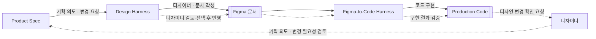

# 전사 공용 AA Workflows 플러그인

- 크루원: 전지원
- 개인 저장소: 사내 배포용 플러그인
- 마지막 갱신: 2026-11-27

## 한 줄 소개

**AA Workflows**는 사내 구성원이 디자인·개발 스킬을 공유하고, 디자이너와 개발자가 같은 요구사항을 기준으로 Figma 문서를 작성하고 구현 결과를 검증하는 데 쓰는 플러그인이다.

## 문제 정의

**Figma 전달물과 코드 사이의 차이를 디자이너와 개발자가 사람 손으로 찾고, 매번 개별 지시로 메우고 있다.**

### AS-IS

| 대상 | 현재 겪는 문제 |
| --- | --- |
| 디자이너 | 공통 프롬프트를 매번 작성하고, Figma 문서 구성과 표현이 기능마다 다르다. 코드와 Figma의 차이를 직접 찾아 AI에게 개별 수정 지시한다 |
| 개발자 | 화면 배치·명명·역할이 파일마다 달라 구현 범위를 파악하기 어렵다. Figma의 컴포넌트·상태가 코드의 어디에 대응하는지 찾아 차이를 직접 확인한다 |

### 원인

- 디자이너: 공통 규칙보다 개별 요청에 따라 문서 작성 방식이 정해진다. 코드 변경과 관련 Figma 항목을 연결할 정보가 부족하다.
- 개발자: 상태만 다른 화면이 반복되고, 컴포넌트·프로퍼티·스타일·변수의 종류와 출처가 구분되지 않는다. 문서에서 설명용으로 쓴 이름을 실제 코드 식별자로 오해하기도 한다.

### TO-BE

- 디자이너: 공통 규칙으로 전달 문서를 작성해 반복 설명과 재작업을 줄이고, 코드 변경을 Figma에 반영하는 시간과 누락을 줄인다.
- 개발자: 화면별 구현 기준과 재현 조건을 빠르게 파악하고, 디자인과 다른 구현이나 빠진 상태·예외 조건을 찾아 수정한다.

## 해결 방식



| 하네스 | 해결 | 판단 기준 |
| --- | --- | --- |
| Design Harness (문서 작성) | 화면 배치·명명·설명·출처 표기 규칙을 정하고 AI에 적용 | 반복 지시 없이도 기준에 맞는 문서가 작성되는가 |
| Figma-to-Code (코드 변경 반영) | AI가 코드와 Figma의 차이를 제시하고, 고른 내용을 반영 | 수정 내용을 일일이 설명하지 않아도 정확히 반영되는가 |
| Figma-to-Code (기능별 구현·리뷰) | 기능별로 구현 범위와 순서를 정하고, 구현·리뷰 후 다음으로 진행 | 기능마다 변경 범위와 완료 여부를 확인할 수 있는가 |
| Figma-to-Code (컴포넌트 대응) | 컴포넌트 구조·이름·프로퍼티·Variant·Status를 코드의 구조·속성·상태값에 그대로 대응 | 코드가 Figma 설계와 일치하고, 임의 변경·누락이 없는가 |
| Figma-to-Code (디자인·구현 검증) | 컴포넌트·상태별로 대응하는 구현 화면·코드와 차이를 정리 | 모든 항목을 빠짐없이 비교하고, 검토한 항목과 남은 항목을 구분할 수 있는가 |

공통 스킬은 제품 조사와 스킬 작성, 디자인 스킬은 Figma 작업과 평가·개선, 개발 스킬은 프론트엔드 규칙 적용과 Figma·코드 대조를 담당한다. Skill Generation으로 새 스킬을 작성·등록하고, Skill Orchestration으로 요청에 맞는 하위 스킬을 골라 다음 단계에 연결한다. Skill Optimization은 팀 리뷰와 작업 세션에서 발견한 문제를 기존 스킬에 반영한다.

### 적용 및 검증 계획

- 한 기능에 먼저 적용하고, 판단 기준과 목표 수준을 적용 전에 정한다.
- 작성·리뷰·수정 시간과 누락 건수를 비교한다. 기준 작성·검토 비용까지 포함해 효과가 없으면 원인과 방법을 고친다.

## OpenAI 기술 활용

- Codex: Codex CLI에서 AA Workflows를 실행한다. 기존 제품의 규칙과 동작을 코드에서 조사하고, 구현이나 문구 수정 시 프론트엔드 코드·문구·Git 작업 규칙을 적용한다.
- OpenAI API: 별도 API 호출 여부는 설명서에 기재되지 않았다.

## 구현 현황

| 기능 | 상태 | 비고 |
| --- | --- | --- |
| AA Workflows | 일부 구현 | Markdown 스킬, Notion·Figma MCP, Git, Codex·Claude·Cursor용 JSON 플러그인 설정으로 구성 |
| Skill Generation (스킬 생성) | 구현 | 공통 영역의 `skill-generation`이 새 스킬을 작성해 해당 도메인에 등록하고, 파일 구조와 경로를 점검 |
| Skill Orchestration (스킬 실행 제어) | 구현 | `common`·`design`·`develop`의 진입 스킬이 요청에 맞는 하위 스킬을 선택해 실행하고 후속 단계로 연결 |
| Skill Optimization (스킬 평가·개선) | 디자인 영역에 적용 | 팀 리뷰와 작업 세션의 피드백으로 디자인 하네스를 수정하고, 같은 사례로 수정 전후 결과를 비교 |
| 제품 저장소 연동 | 개발 브랜치 병합 | 코드 조사·구현·문구 수정 전에 스킬을 읽도록 제품 저장소의 `AGENTS.md`에 연결 |
| 디자인·개발 전달 | 시연 | Product Spec으로 Figma 전달 자료를 작성하고, 별도 Codex 세션에서 해당 자료를 기준으로 구현 |
| Figma·코드 대조 | 적용 | 요구사항·화면 상태를 실제 코드 위치와 연결하고, 누락·불일치·남은 검증 항목을 보고 |
| 팀 피드백 반영 | 적용 | 실제 번역 문구의 잘림과 스크롤 후 조작을 해당 화면에서 확인하도록 검수 규칙에 반영 |

## 막힌 점과 배운 점

- **막힌 점: 과도기라는 인상**

  하네스 개선 절차와 문서 관리 방식이 아직 자리를 잡아가는 중이라고 느꼈음

  - **하네스 설계·운영 방식의 표준화 부족**
    - 실무에서 바로 참고할 공통 기준이 부족하다고 느꼈음. 예를 들어 self-improving harness 에 대한 담론이 많았지만, 실제로 적용하기 위해 `team-based-improvements`의 입출력은 직접 설계해야 했음.
  - **자연어 지침의 누적 문제**
    - 지침을 추가하다 보면 앞뒤가 맞지 않거나 기존 지침과 충돌할 수 있다. 같은 내용을 반복하거나 실행에 도움이 되지 않는 문장도 쌓일 수 있음

      ```markdown
      # AGENTS.md
      - dev 브랜치에 직접 커밋하지 않는다.

      # SKILL.md
      - 작업 완료 후 현재 브랜치에 커밋한다.
      ```

- **배운 점: 두 가지 질문을 던지게 됨**
  - **판단 기준이 명확한 규칙은 어디까지 코드로 옮길 수 있을까?** 하네스 문서에도 린터로 지침의 중복이나 충돌 가능성을 짚고, 포맷터로 형식을 맞추는 방식이 표준으로 자리 잡을지 궁금하다.
  - **모든 UI 컴포넌트를 Figma에서 먼저 설계해야 할까?** 비즈니스 로직이 없는 컴포넌트라면 디자이너가 코드로 직접 만들고 화면에서 확인하는 편이 더 자연스러울 수 있다. 그러면 같은 화면을 Figma에서 설계한 뒤 다시 코드로 옮기는 단계도 줄어든다.

## 평가·검증 결과

- Figma 전달 자료에 검토할 화면과 변경 범위를 표시한 뒤, 개발 요청 때 어디를 보고 무엇을 수정해야 하는지 다시 설명하는 일이 줄었다.
- 구현 결과에 화면 상태별 코드 위치와 남은 검증 항목을 기록해 사람이 이어서 확인할 수 있게 했다. 작성·리뷰·수정 시간과 누락 건수의 전후 측정값은 두 자료에 기재되지 않았다.

## 차별점과 확장 계획

- 검증과 팀 리뷰에서 발견한 문제를 평가·개선 스킬로 다음 작업의 규칙에 반영한다. 세션 요약과 스케줄링을 활용해 작업 대화에서 발견한 문제도 반영하는 과정을 보강한다.
- 구성원이 개별적으로 쓰던 스킬을 모으고, 릴리스 노트 작성으로 적용 범위를 넓힌다.
- 디자인 검수에서는 화면 배치·이름, Variant와 상태의 구분, 짧고 쉬운 설명, 실제 명칭과 출처를 점검한다. 디자인 시스템 변경 표에서는 심볼·코드 이름·상태를 구분한다.

## 결과물·실행 방법

- 저장소: AA Workflows는 사내 비공개 저장소로 운영하므로, 결과물은 [README.md](https://app.notion.com/p/swits/423d39944fb980ccbea9c1c744852ba3#423d39944fb980eb83a4cf9ce405a1b6)와 [디렉토리 구조](https://app.notion.com/p/swits/423d39944fb980ccbea9c1c744852ba3#423d39944fb980219fabc4fcac861057)로 대체한다.

  ```markdown
  # AA Workflows

  사내 팀이 개발·디자인·공용 스킬을 도메인별로 등록하고 공유하는 플러그인입니다.

  새 개발 스킬은 `develop`에, 디자인 스킬은 `design`에 추가합니다. 릴리즈 노트 작성이나 제품 가이드처럼 팀이 함께 쓰는 스킬은 `common`에 둡니다.

  ## 스킬 추가·개선·실행

  | 역할 | 진입점 | 하는 일 |
  | --- | --- | --- |
  | **Skill Generation** | [`common` → `skill-generation`](plugins/aa-workflows/skills/common/skills/skill-generation/SKILL.md) | 새 스킬을 작성하고 도메인에 등록합니다. 구조가 어긋나면 이유와 권장 경로를 안내합니다. |
  | **Skill Optimization** | `design` → [평가](plugins/aa-workflows/skills/design/evals/evaluation.md) · [개선](plugins/aa-workflows/skills/design/references/improvement.md) | 디자인 하네스를 팀·세션 피드백으로 개선하고 같은 케이스에서 전후 결과를 비교합니다. 개발 스킬의 평가·개선 절차는 아직 없습니다. |
  | **Skill Orchestration** | [`design`](plugins/aa-workflows/skills/design/SKILL.md) · [`develop`](plugins/aa-workflows/skills/develop/SKILL.md) · [`common`](plugins/aa-workflows/skills/common/SKILL.md) | 각 도메인에서 요청에 맞는 하위 스킬을 선택해 실행하고 필요한 후속 절차로 연결합니다. |

  스킬을 추가하려면 Claude Code에서 `/aa-workflows:common`, Codex에서 `$common`을 선택하고 “AA Workflows에 릴리즈 노트 스킬을 추가하는 방법을 알려줘”라고 요청하세요.

  ## 설치

  **사용하는 환경을 누르면 설치 방법으로 이동합니다.** Claude CLI·Cursor는 안내된 프롬프트를 복사해 입력하세요.

  | 환경 | 필요사항 | 자동 업데이트 여부 |
  | --- | --- | :---: |
  | [Codex & GPT Desktop(GUI)](docs/distribution.md#codex--gpt-desktopgui) | Codex CLI · GitLab 원격 소스 등록 | 원격 등록·인증 확인 필요 |
  | [Claude Chat/Cowork(GUI)](docs/distribution.md#claude-chatcoworkgui) | 사내 Claude Enterprise 계정 · 조직 필수 설치 | 조직 동기화 설정에 따름 |
  | [Claude CLI](docs/distribution.md#claude-cli) | Claude CLI | ✅ |
  | [Cursor](docs/distribution.md#cursor) | Claude CLI · Third-Party Imports 설정 | ✅* |
  | [pi](docs/distribution.md#pi) | pi CLI | ✅** |

  *Cursor는 Claude CLI에서 갱신된 설치본을 가져옵니다. 자동 업데이트 활성화와 적용 시점은 각 환경의 설치 안내를 참고하세요. **pi는 태그로 고정하지 않고 설치했을 때만 세션을 시작할 때 자동 갱신됩니다.

  Claude Chat/Cowork에서 조직 배포가 적용되지 않으면 ZIP으로 수동 설치하세요.

  CLI 설치에는 [GitLab 저장소](#마스킹됨)의 읽기 권한과 Git 인증이 필요합니다. Figma·Notion 연결은 별도로 설정하세요.

  Codex는 플러그인 활성화와 마켓플레이스 소스 등록을 별도로 확인해야 합니다. 재시작 후에도 이전 버전이면 [등록 소스 확인·복구와 수동 갱신](docs/distribution.md#자동-갱신이-반영되지-않을-때만)을 따르세요.

  ## 포함된 스킬

  | 도메인 | 진입 스킬 | 하는 일 |
  | --- | --- | --- |
  | 디자인 | `design` | Figma 디자인·개발 전달·파일 정리와 디자인 하네스 평가·개선 |
  | 개발 | `develop` | GitLab `[팀명]/frontend/` 저장소의 Figma 핸드오프 검토·구현·검증(`aa-frontend-figma-to-code`)과 코드 컨벤션(`aa-frontend-code-conventions`) |
  | 공용 | `common` | `[팀명]-product-guide`로 제품 근거 조사, `skill-generation`으로 플러그인 스킬 작성·등록 |

  ## 사용 방법

  - **팀 피드백 기반 개선:** “`design`에서 팀 피드백을 읽고 디자인 하네스 개선해줘.” — 피드백의 원인을 조사해 문서·절차 문제는 확인된 로컬 하네스를 직접 수정하고, Figma 파일·컴포넌트 문제는 필요한 변경을 구체적으로 안내합니다. 응답에는 판단 근거, 수행한 변경, 남은 작업을 설명하고, 기존 노션 Comments DB에는 그 결과를 기록합니다. 설치·배포·예약 실행은 별도입니다.
  - **디자인 작성·점검:** “`design`으로 이 Spec을 읽고 Figma 화면과 전달 문서를 작성해줘.”
  - **코드 구현:** “`develop`에서 이 Figma 릴리스 섹션을 읽고, 연결된 Spec과 화면 카드에 맞춰 구현해줘.”
  - **디자인 하네스 비교:** “디자인 하네스를 쓴 경우와 쓰지 않은 경우를 비교해줘.” — 등록된 기본 입력으로 조건별 새 컨텍스트에서 바로 실행합니다. 하나의 지정 Figma 파일 안 새 페이지 4개에 디자인·개발 전달의 첫 결과를 보존하고, 원샷 성공·실패를 품질·토큰·시간과 함께 비교합니다. 잘못된 파일에 작성하거나 진단 문서만 제출해도 원샷 실패입니다. 실제 토큰 로그와 검증된 X 격리를 사용하며, 미실행·미측정 수치를 만들지 않습니다.
  - **하네스 수정 검증:** “이번 디자인 하네스의 수정 전후를 같은 케이스로 비교해줘.” — 수정 전·후의 스킬 사본을 같은 입력과 판정 기준으로 실행하고, 문제 해결 여부와 기존 동작의 회귀를 기록합니다. [디자인 하네스 평가](plugins/aa-workflows/skills/design/evals/evaluation.md)

  일반 디자인·구현 요청에는 Product Spec 링크와 Figma 대상 링크를 함께 전달하세요. 하네스 미사용·사용 비교에서 링크를 생략하면 디자인 평가에 등록된 기본값을 사용하며 다시 묻지 않습니다. 결과는 기본 공통 Figma 파일 하나 안에 조건·단계별 새 페이지 4개로 보존합니다. 다른 출력 파일은 사용자가 명시했을 때만 사용합니다.

  설치·업데이트 문제는 [설치 안내](docs/distribution.md#설치가-안-될-때), 배포 관리는 [관리자 안내](docs/distribution-admin.md)를 참고하세요.

  ## 플러그인 버전 관리

  커밋할 때 `plugins/aa-workflows/plugin.json`을 기준으로 네 매니페스트의 버전을 맞추고 변경 이력을 기록합니다. 스킬을 추가하거나 위치·이름·진입점을 바꾼 경우 Skill Generation 가이드로 구조도 확인합니다.

  [버전 관리 안내](docs/versioning.md) · [변경 이력](CHANGELOG.md)
  ```

  ```text
  plugins/aa-workflows/
  ├── .claude-plugin/plugin.json  # Claude용 플러그인 설정
  ├── .codex-plugin/plugin.json  # Codex용 플러그인 설정
  ├── .cursor-plugin/plugin.json  # Cursor용 플러그인 설정
  ├── plugin.json  # 공통 플러그인 정보와 버전
  ├── references/
  └── skills/
      ├── common/
      │   ├── SKILL.md  # 제품 조사와 스킬 작성 요청을 연결
      │   └── skills/
      │       ├── [팀명]-product-guide/SKILL.md  # 기존 제품 규칙·동작·코드 근거 조사
      │       └── skill-generation/SKILL.md  # 새 스킬 작성·등록과 구조 검토
      ├── design/
      │   ├── SKILL.md  # 디자인 작업·평가·개선 요청을 연결
      │   ├── evals/
      │   │   └── evaluation.md  # 하네스 사용·미사용과 수정 전후 비교
      │   ├── references/
      │   │   ├── improvement.md  # 피드백 출처에 맞는 개선 절차 선택
      │   │   └── session-based-improvement.md  # 작업 세션에서 발견한 문제 반영
      │   └── skills/
      │       ├── aa-design-component-page/SKILL.md  # (by 디자이너) Figma 컴포넌트 페이지 정리
      │       ├── aa-design-file-setup/SKILL.md  # (by 디자이너) Figma 파일에 템플릿·프로젝트 설정 준비
      │       ├── aa-design-process/SKILL.md  # (by 디자이너) Spec을 디자인과 개발 전달 초안으로 구체화
      │       ├── aa-design-release-handoff/SKILL.md  # (by 디자이너) 개발 전달 전 화면 카드와 규칙 검수
      │       ├── aa-design-screen-canon-update/SKILL.md  # (by 디자이너) 구현·QA 후 화면 정본 갱신
      │       ├── aa-design-system-handoff-review/SKILL.md  # (by 디자이너) 컴포넌트·변수·스타일의 Figma와 코드 대조
      │       ├── aa-design-team-based-improvement/SKILL.md  # 팀 피드백에서 개선 항목을 찾아 반영
      │       └── aa-design-workflow-update/SKILL.md  # 디자인 절차와 템플릿의 개선안 반영
      └── develop/
          ├── SKILL.md  # 개발 요청에 맞는 하위 스킬을 연결
          └── skills/
              └── frontend/
                  ├── aa-frontend-code-conventions/SKILL.md  # 프론트엔드 코드·문구·Git 작업 규칙 적용
                  └── aa-frontend-figma-to-code/SKILL.md  # Figma 기준으로 구현하고 코드와 대조
  ```

- 실행 방법: AA Workflows가 설치된 Codex CLI에서 Product Spec과 대상 Figma 페이지를 지정해 디자인과 개발 전달 자료 작성을 요청한다. 새 Codex 세션에서 완성된 Figma 핸드오프를 지정해 구현을 요청한다.
- 시연영상: [디자인 과정](https://app.notion.com/p/swits/423d39944fb980ccbea9c1c744852ba3#423d39944fb980079631cf4b13abddb3) | [개발 과정](https://app.notion.com/p/swits/423d39944fb980ccbea9c1c744852ba3#423d39944fb980588502f4185232e2a7)
