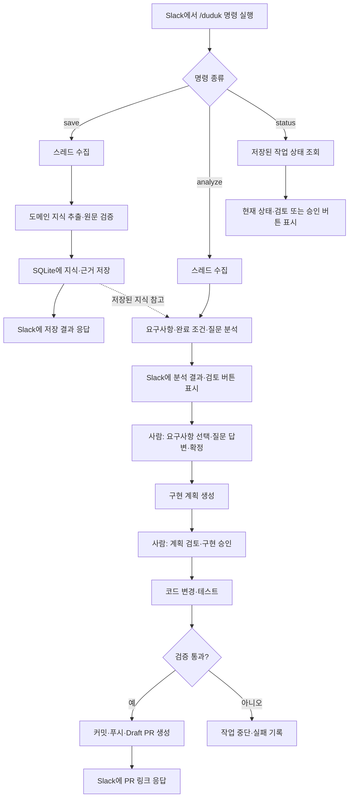

# Slack 논의 기반 개발 보조 에이전트

Slack 스레드 논의에서 원문 근거가 있는 요구사항을 뽑고, 사람이 요구사항과 구현 계획을 승인하면 코드 변경·테스트·Draft PR까지 진행하는 에이전트

- 크루원: 노유나
- [프로젝트 저장소](https://github.com/vipwhy12/slack-dev-assistant) · [구현 PR](https://github.com/vipwhy12/slack-dev-assistant/pull/1)
- 마지막 갱신: 2026-11-20

## 문제 정의

Slack 스레드에는 개발 요청, 추가 조건, 도메인 규칙이 흩어져 있다. 이를 개발로 옮기려면 사람이 내용을 정리하고 구현 범위를 확인해야 한다.

사이드 프로젝트에 적용해 **논의 정리 → 요구사항 검토 → 구현 승인 → 개발·PR**을 하나의 흐름으로 연결한다.

## 사용 방법

| 명령 | 기능 |
| --- | --- |
| `/duduk save <스레드 링크>` | 도메인 지식을 원문 근거와 함께 SQLite에 저장 |
| `/duduk analyze <스레드 링크>` | 요구사항·완료 조건·미해결 질문 분석 |
| `/duduk status <작업 ID>` | 작업 상태와 검토·승인 버튼 확인 |

Slack 명령어에 따라 다음과 같이 진행한다.



점선은 분석 시 저장된 지식을 참고한다는 뜻이다. 저장만으로 분석이나 개발을 시작하지 않는다.

명령은 해당 채널의 기본 입력창에서 실행한다. 스레드는 명령 실행 시 수집하며, 로컬 작업 프로세스가 켜져 있어야 한다.

## 핵심 하네스 설계

- **원문 근거 검증**: 요구사항·완료 조건의 인용이 실제 메시지와 일치하는지 검사한다.
- **단계별 승인**: 요구사항 검토와 구현 승인을 분리한다. 저장·분석만으로 코드를 수정하지 않는다.
- **실행 범위 제한**: 승인한 버전·저장소·변경 경로에 맞춰 작업하고, 격리된 환경에서 테스트한다.
- **중복·비용 관리**: SQLite 작업 큐와 일회용 승인으로 중복 실행을 막는다. 같은 저장 경로의 모델 호출에 누적 예산을 적용한다.
- **실패 시 중단**: 근거·승인·테스트 검증에 실패하면 다음 단계로 진행하지 않는다.

SQLite에는 원문 버전, 추출한 지식과 근거, 검토·승인 이력, 작업 상태와 추정 비용을 저장한다.

## OpenAI 기술 활용

- **Codex**: 설계, TypeScript 구현, 테스트, Slack 연결 검증과 PR 작성에 활용했다.
- **OpenAI API**: `gpt-4.1-mini`로 지식·요구사항·계획·코드 변경안을 생성하고 Zod와 별도 검증 로직으로 검사한다.

## 구현·검증 현황

| 항목 | 확인한 결과 |
| --- | --- |
| 자동 테스트 | 17개 파일·265개 테스트 통과 |
| 실제 Slack 지식 저장 | 지식 4건·원문 근거 4개 저장 |
| 실제 Slack 요구사항 분석 | 요구사항 3개·완료 조건 3개·원문 근거 6개 추출 |
| 검토 화면 | 열기·취소 확인 |
| 계획·구현·Draft PR | 구현·자동 테스트 완료. 실제 Slack 승인부터 PR까지의 전체 실행은 검증 예정 |
| 배포 | 대상 프로젝트에 연결 PR 작성. 실제 배포는 설정·검증 필요 |

자동 테스트에는 외부 서비스를 대체한 검증이 포함된다. 실제 연결 테스트의 모델 호출은 3회, 추정 비용은 **$0.0056**이었다. 실패한 첫 저장 호출도 포함한 값이다. [자동 테스트·빌드 CI](https://github.com/vipwhy12/slack-dev-assistant/actions/runs/44521443102)

## 막힌 점과 배운 점

- **형식 검증만으로는 부족했다.** 첫 저장 테스트에서 모델의 인용이 원문과 달라 저장을 차단했다. 이후 별도 테스트 스레드에서 저장에 성공했다.
- **구현과 실제 동작 확인을 구분해야 했다.** 자동 테스트에 더해 Slack 명령, DB 기록, 원문 근거, 승인 상태를 대조해 검증 범위를 확인했다.

## 차별점과 다음 계획

원문을 추적할 수 있는 요구사항과 단계별 승인을 중심으로, AI가 진행할 수 있는 범위를 제어한다.

1. 실제 Slack 승인부터 코드 변경·테스트·Draft PR까지 검증
2. 중복 요청·프로세스 중단·모델 오류에 대한 복구 검증
3. 사람 수정률·개입 시간·작업당 비용 측정

## 실행 방법

Slack 앱과 토큰, 프로젝트 설정을 준비한 뒤 실행한다.

```sh
node dist/cli.js serve-slack --config slack-dev.config.json
```

- [설치·권한·설정 가이드](https://github.com/vipwhy12/slack-dev-assistant/blob/8bb4478883286c6ae64f90be401a6b0fb021b85f/docs/slack-commands.md)
- 시연영상: 준비 예정

## 사용 기술

TypeScript · Node.js · Zod · SQLite · Slack Web API / Socket Mode · Docker · GitHub Actions · OpenAI API
