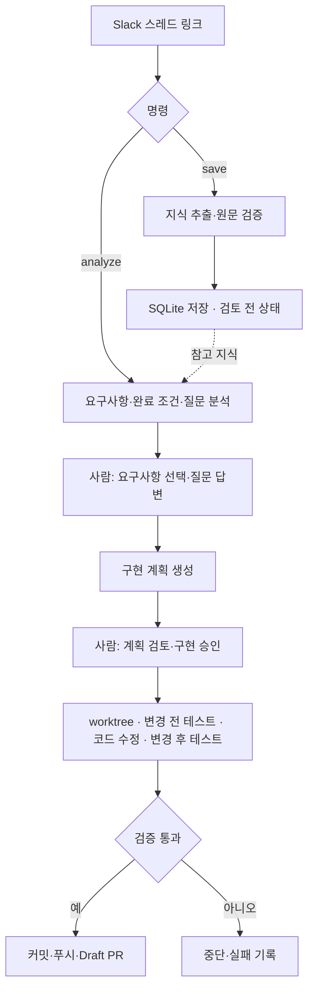

# Slack 논의 기반 개발 보조 에이전트

- 크루원: 노유나
- 개인 저장소: [slack-dev-assistant](https://github.com/vipwhy12/slack-dev-assistant)
- 구현 PR: [Slack 명령·지식 저장·승인 기반 개발 흐름 #1](https://github.com/vipwhy12/slack-dev-assistant/pull/1)
- 마지막 갱신: 2026-11-20

## 한 줄 소개

Slack 논의를 원문 근거가 있는 지식과 요구사항으로 정리하고, 사람이 요구사항과 구현 계획을 승인하면 코드 변경·테스트·Draft PR까지 진행하도록 만든 개발 보조 에이전트.

## 문제 정의

적용 대상은 가계부 프로젝트 `duduk`의 Slack 개발 채널이다. 스레드의 요청을 개발 작업으로 옮기려면 요청 내용, 뒤에 추가된 조건, 변경하지 않을 범위를 함께 읽고 정리해야 한다. 논의가 끝났는지와 실제 구현을 승인했는지도 확인해야 한다.

이 도구는 도메인 지식을 원문과 연결해 보관하고, 구현할 요구사항·완료 조건·남은 질문을 사람이 검토할 수 있게 한다. 검토한 범위와 승인된 계획에 맞는 변경을 테스트하고 PR로 전달하는 것이 목표다.

실제 연결 검증에는 웹 달력 날짜 버튼의 선택 상태를 `aria-pressed`로 표시하는 테스트 스레드를 사용했다. 댓글에 추가된 적용 범위와 완료 조건까지 수집했다. 이 스레드는 기능 확정이나 구현 승인을 의미하지 않는 테스트 자료였다. 실제 팀의 작업 시간 절감 효과는 아직 측정하지 않았다.

## 해결 방식

입력은 허용된 Slack 채널의 스레드 링크다. 출력은 원문 근거를 포함한 지식·요구사항, 검토·승인 이력, 구현 결과와 Draft PR이다. 명령은 대상 스레드와 같은 채널의 기본 입력창에서 실행한다.

| 명령·단계 | 하는 일 |
| --- | --- |
| `/duduk save <스레드 링크>` | 도메인 용어·규칙·결정·관계를 메시지 버전·인용 근거와 함께 SQLite에 정규화해 저장한다. 결과는 `unreviewed`이며 확정된 운영 정책이나 구현 승인이 아니다. |
| `/duduk analyze <스레드 링크>` | 스레드와 저장된 참고 지식으로 요구사항·완료 조건·질문을 정리한다. 현재 요구사항의 근거는 현재 스레드에서 검증한다. |
| 요구사항 검토 → 계획 생성 | 사람이 검토 모달에서 구현할 요구사항을 선택하고 차단 질문에 답한다. 검토된 범위와 저장소를 바탕으로 계획을 생성한다. |
| 계획 승인 → 구현·PR | 별도 실행 승인 후 worktree에서 변경 전 테스트, 코드 수정, 변경 후 Docker 테스트를 수행하고 통과한 변경을 커밋·푸시해 Draft PR로 게시한다. |
| `/duduk status <작업 ID>` | 진행 상태와 검토·승인 버튼을 다시 확인한다. |

아래는 구현한 처리 흐름이다. 실제 Slack에서 확인한 구간은 저장·분석·검토창 열기와 취소까지이며, 승인 이후 전체 실행은 추가 검증 과제다.



PR 이후의 리뷰·병합은 사람이 수행한다. `main` 병합 후 CI 검증과 네이버 클라우드 서버 배포 연결은 대상 프로젝트의 별도 Draft PR에 준비했다. 배포 활성화·서버 설정·실제 운영 배포 검증은 남아 있고, AI 리뷰봇 설치는 보류했다. 대상 프로젝트는 비공개이므로 외부 검증 근거는 이 문서의 공개 도구 저장소와 CI 링크를 사용한다.

### 하네스 포인트

- **원문 근거 검증**: 요구사항과 완료 조건에 메시지 참조와 인용문(`sourceRefs`)을 연결한다. 메시지가 존재하는지, 인용이 원문과 일치하는지 확인하고 근거 없는 결과는 거부한다.
- **사람 승인 단계**: 모델 초안은 차단 질문이 없어도 사람 검토 전까지 `needs_input`이다. 검토 후 조건을 충족한 `ready`도 구현 허가가 아니며, 계획 확인 후 별도 실행 승인이 필요하다.
- **고정된 실행 허가**: 허가는 검토한 요구사항 버전·저장소 커밋·설정에 연결된다. 기준이 달라지면 이전 승인을 그대로 사용하지 않는다. 수정 경로와 실행할 테스트 명령도 설정으로 제한한다.
- **예산 가드**: 유료 호출 전 최대 예상 비용을 예약하고 응답 토큰으로 추정 비용을 정산한다. 기본 한도는 $10이며 더 낮게 설정할 수 있다. 같은 `storageDir/budget.sqlite`의 호출에 적용되며 OpenAI 계정 전체 청구 한도는 아니다. 사용량이 불명확하면 예약액을 유지한다.
- **작업 처리 안정성**: SQLite 영속 큐, 이벤트 중복 방지, 일회용 승인 식별자와 작업 잠금을 사용한다. 중단된 작업은 확인 없이 유료 호출이나 구현을 자동 반복하지 않는다. 자체 봇 출력은 다음 분석 원문에서 제외한다.
- **검증 실패 시 중단**: 스키마·원문 근거·승인·테스트 중 조건을 충족하지 못한 단계에서는 다음으로 진행하지 않는다. 테스트 실패를 자동 병합이나 배포로 넘기지 않는다.

### 저장하는 데이터

| 저장소 | 기록하는 내용 |
| --- | --- |
| `knowledge.sqlite` | 프로젝트·스레드·수집 스냅샷·메시지 버전, 지식 항목·관계·근거·미해결 사항 |
| `history.sqlite` | 분석·사람 검토 버전, 계획, 실행 허가, 구현·검증 체크포인트 |
| `slack-jobs.sqlite` | Slack 요청·작업 상태, 중복 방지 정보, 승인 식별자·작업 잠금 |
| `budget.sqlite` | 모델 호출별 예약액, 확인된 토큰 사용량·추정 비용 |

원문이 바뀌면 이전 버전을 보존하고 새 수집본을 기록한다. 저장된 지식은 자동으로 확정 사실이 되지 않는다. 런타임 데이터와 토큰은 Git에서 제외하며 공개 문서에는 실제 Slack 원문·내부 링크·DB 파일을 첨부하지 않는다.

## OpenAI 기술 활용

- **OpenAI API**: `gpt-4.1-mini`로 지식 추출·요구사항 분석·계획·구현 변경안을 생성한다. Zod 스키마 검사 후 원문 근거와 실행 조건을 별도로 검증한다. 현재 비용 계산을 지원하는 모델로 제한한다.
- **Codex**: CLI·데이터 구조·승인 흐름 설계, TypeScript 구현, 테스트 작성·실행, GitHub PR 준비와 실제 Slack 연결 검증에 개발 보조 도구로 활용했다. 코드와 실제 검증 결과를 대조해 동작 범위를 확인했다.
- **역할 구분**: 현재 Slack 작업 중 모델 생성은 OpenAI API가 담당한다. Codex를 매 요청마다 실행하는 구조나 로컬 모델 연동은 구현하지 않았다.

## 구현 현황

| 기능 | 구현 상태 | 확인한 범위·남은 일 |
| --- | --- | --- |
| Slack 수집·요구사항 분석 | 구현·실제 연결 검증 | 테스트 스레드에서 요구사항 3개·완료 조건 3개·원문 근거 6개 확인 |
| 도메인 지식 저장 (`save`) | 구현·실제 연결 검증 | 별도 테스트 스레드에서 지식 4건·원문 근거 4개 저장, 모두 검토 전 상태 |
| Slack 명령·검토 화면 (`serve-slack`) | 구현·실제 연결 검증 | 가계부 연결, 명령·상태 조회, 검토창 열기·취소 확인 |
| 계획·구현·Draft PR 게시 | 구현·자동 테스트 | 실제 Slack 승인부터 대상 프로젝트 코드 수정·PR 생성까지의 전체 실행은 미검증 |
| `main` 병합 후 CI·배포 | 대상 저장소에 연결 PR 작성 | Draft·미병합 상태. 배포 활성화·서버 설정과 운영 배포 검증 필요 |
| 상시 운영 | 로컬 실행 방식 | Mac과 작업 프로세스 실행 필요. 상시 서버 운영·백업 복구 검증 필요 |

구현 PR과 배포 연결 PR은 갱신 시점에 모두 Draft 상태다. Socket Mode는 명령·버튼 입력을 받는 연결이며, 스레드 수집은 `save`·`analyze` 실행 시 수행한다. 새 대화를 실시간으로 DB에 동기화하지 않는다.

## 평가·검증 결과

자동 테스트와 실제 외부 서비스 검증을 분리해 기록한다.

| 검증 | 결과 | 범위와 한계 |
| --- | --- | --- |
| 자동 테스트 | **17개 파일·265개 테스트 통과**, 2026-11-20 `npm test` 재확인 | 외부 Slack·모델·PR 경계를 대체한 검증 포함. 테스트 수는 모델 정확도나 운영 성공률을 뜻하지 않는다. |
| 타입 검사·빌드·CI | 구현 커밋의 `npm run check`와 GitHub Actions 통과 | [해당 CI 실행](https://github.com/vipwhy12/slack-dev-assistant/actions/runs/44521443102) 참고 |
| 고정 JSON 개발 스모크 | 모델 API 비용 $0으로 계획·변경 적용·검증·재개 흐름 확인 | 합성 입력·임시 저장소 사용. 실제 Slack 메시지나 GitHub PR을 게시하지 않는다. |
| 실제 Slack 지식 저장 | 지식 4건·원문 근거 4개 저장, FK 검사 통과 | 2026-11-19 테스트용 도메인 메모 1개. 운영 정책으로 승인한 지식이 아니다. |
| 실제 Slack 요구사항 분석 | 요구사항 3개·완료 조건 3개·원문 근거 6개 | 2026-11-19 사람 메시지 3개로 구성된 테스트 스레드 1개 |
| 실제 Slack 검토창 | 열기·취소 성공, 검토 승인 0건 | 취소 후 승인 식별자 미사용. 이 테스트에서 계획·구현·PR·병합·배포는 실행하지 않았다. |
| 실제 연결 테스트 비용 | 모델 호출 3회, 추정 합계 **$0.0055944** | 실패한 첫 저장 포함. 응답 토큰·설정 단가 기준이며 계정 청구서 총액이 아니다. |

연결 테스트는 이전 사용량도 고려해 해당 작업의 누적 예산을 $6.70으로 설정했다. 별도로 제공하는 `--live` 개발 스모크는 합성 대화·임시 저장소에서 모델을 최대 두 번 호출하고 해당 테스트 예산을 $0.90으로 제한한다. 재현 절차는 [구현 버전의 README](https://github.com/vipwhy12/slack-dev-assistant/blob/8bb4478883286c6ae64f90be401a6b0fb021b85f/README.md)를 참고한다.

표본이 작아 요구사항 정확도, 사람 수정률, 작업 시간 절감률, 전체 PR 생성 성공률은 아직 산출하지 않았다.

## 막힌 점과 배운 점

| 상황 | 원인·대응 | 배운 점·남은 개선 |
| --- | --- | --- |
| 첫 실제 `save` 실패 | 모델 인용이 제공한 메시지 버전의 원문과 정확히 일치하지 않아 저장 차단. 저장 항목 0건, 자동 재호출 없음 | JSON 형식이 맞아도 근거가 정확하다는 보장은 없다. 별도 단순 스레드에서 4건 저장을 확인했지만 첫 실패를 수정 완료로 간주하지 않는다. 거부한 응답의 진단 자료 보존은 개선 과제다. |
| 기존 Slack 앱 설정 변경 불가 | 현재 계정에 기존 앱 관리 권한이 없어 새 앱을 만들고 승인된 권한으로 설치·연결 | 앱 소유권, OAuth 읽기·쓰기 권한, Socket Mode 연결 토큰을 구분해 확인해야 한다. |
| 실제 구현 여부 판단 | 자동 테스트와 실제 Slack 명령 검증을 나누고 DB·원문 근거·승인 상태와 대조 | 구현 완료, 자동 테스트 통과, 실제 서비스 검증 완료를 따로 기록해야 진행 상태를 정확히 전달할 수 있다. |
| 지식과 승인 이력의 구분 | 메시지 버전·추출 결과·사람 검토·실행 허가를 각각 저장하고 참조 관계 연결 | 데이터 구조와 상태 전이에서 모델의 해석이 구현 승인으로 취급되지 않도록 구분해야 한다. |

## 차별점과 확장 계획

- **원문 추적**: 지식과 요구사항이 어떤 메시지 버전·인용에서 나왔는지 확인한다.
- **단계별 사람 판단**: 요구사항 검토와 구현 승인을 구분하고 승인 당시의 버전·변경 범위에 실행을 묶는다.
- **작업 단위의 실패·비용 관리**: 영속 큐·중복 방지·예산 원장·검증 체크포인트로 다음 단계 진행 여부를 판단한다.

다음 검증과 개발은 아래 순서로 진행할 계획이다.

1. 테스트용 변경으로 실제 Slack 승인 → 계획 → 코드 수정·테스트 → Draft PR까지 전체 흐름을 검증한다.
2. 중복 요청·프로세스 중단·모델 오류를 재현하고 복구 절차를 정리한다. 상시 실행·상태 조회·장애 알림·DB 백업 복구를 보완한다.
3. 같은 평가용 스레드 집합으로 원문 근거 검증 통과율, 사람의 요구사항 수정률·개입 시간, 작업당 비용·처리 시간을 측정한다.
4. 실제 사용에서 병목이 확인되면 로컬 모델과 API 모델을 같은 입력으로 비교한다. 로컬 모델 전환과 비용·품질 비교는 현재 미구현이다.

## 결과물·실행 방법

- 코드·전체 실행 안내: [slack-dev-assistant](https://github.com/vipwhy12/slack-dev-assistant)
- 이번 구현 내용: [Draft PR #1](https://github.com/vipwhy12/slack-dev-assistant/pull/1)
- 설치·권한·명령 안내: [검증한 구현 버전의 Slack 연결 가이드](https://github.com/vipwhy12/slack-dev-assistant/blob/8bb4478883286c6ae64f90be401a6b0fb021b85f/docs/slack-commands.md)
- 시연영상: 미제작. 공개 가능한 테스트 자료로 저장·분석·검토 흐름을 녹화할 예정이다.

현재 Slack 기능은 구현 PR 브랜치 `slack-dev/plan-implement-20261119`에 있다. 해당 브랜치에서 의존성 설치와 빌드 후 `.env.example`을 참고해 `.env`를 구성한다. 수집용 `SLACK_TOKEN`, 응답용 `SLACK_BOT_TOKEN`, Socket Mode용 `SLACK_APP_TOKEN`, 모델 호출용 `OPENAI_API_KEY`와 프로젝트 설정 파일이 필요하다. Slack 앱 설치·채널 추가 후 CLI 저장소 디렉터리에서 실행한다.

```sh
node dist/cli.js serve-slack --config slack-dev.config.json
```

```text
/duduk save <같은 채널의 스레드 링크>
/duduk analyze <같은 채널의 스레드 링크>
/duduk status <작업 ID>
```

로컬 프로세스 종료나 Mac 잠자기로 연결이 끊기면 명령을 처리할 수 없다. 토큰·설정 파일·실제 Slack 대화가 담긴 런타임 데이터는 공개 저장소에 올리지 않는다.

## 사용 기술

TypeScript, Node.js 24, Zod, SQLite, Slack Web API·Socket Mode, Docker, GitHub Actions, OpenAI API
